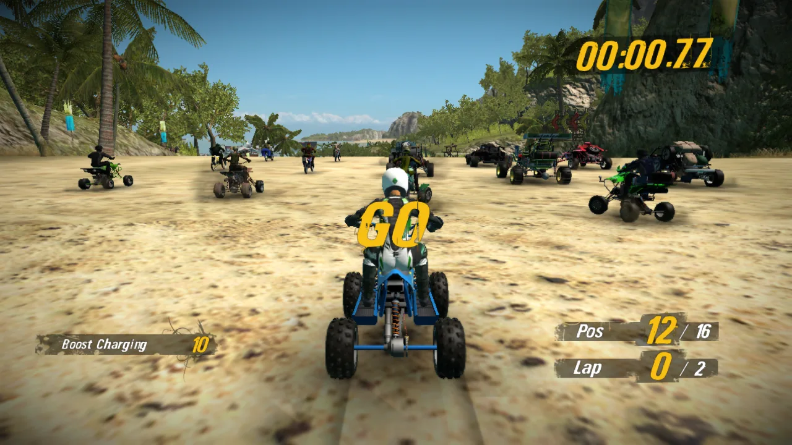
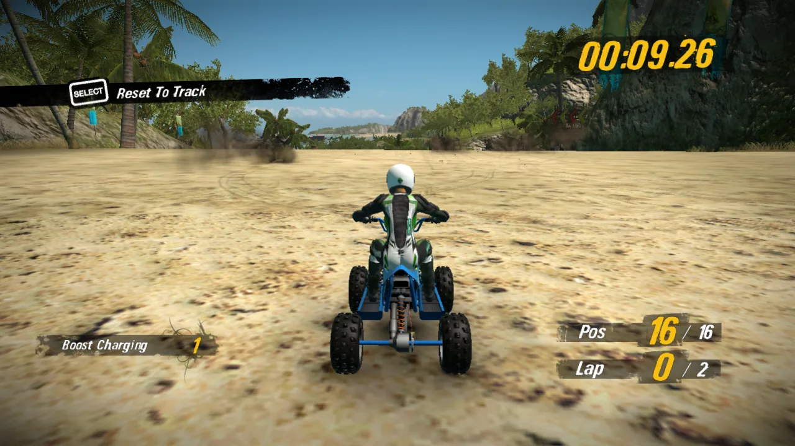
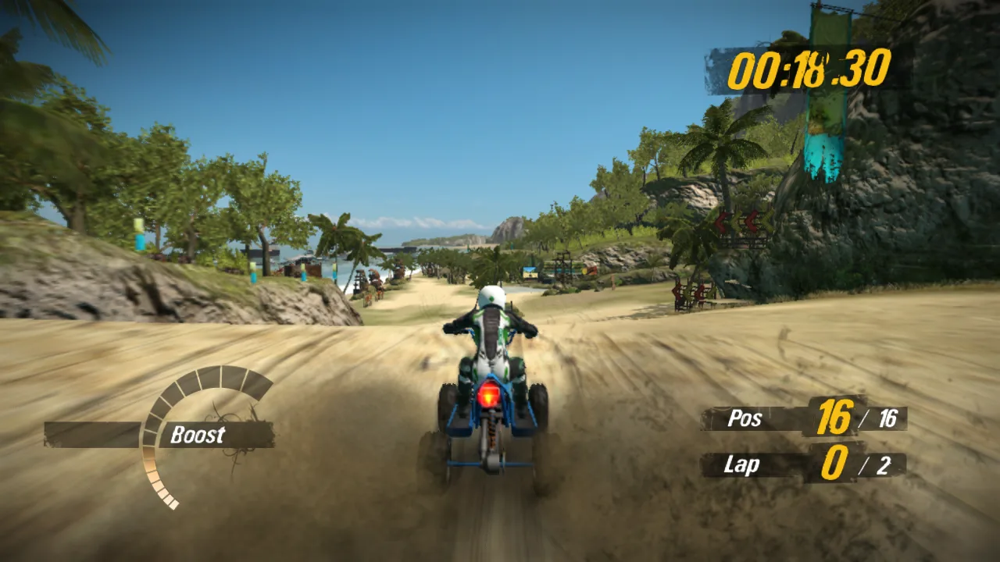
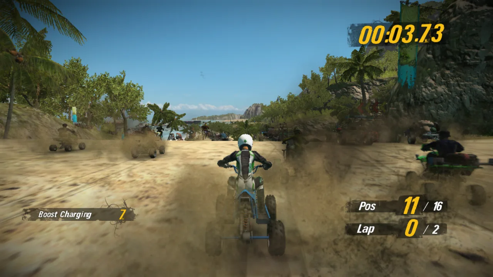
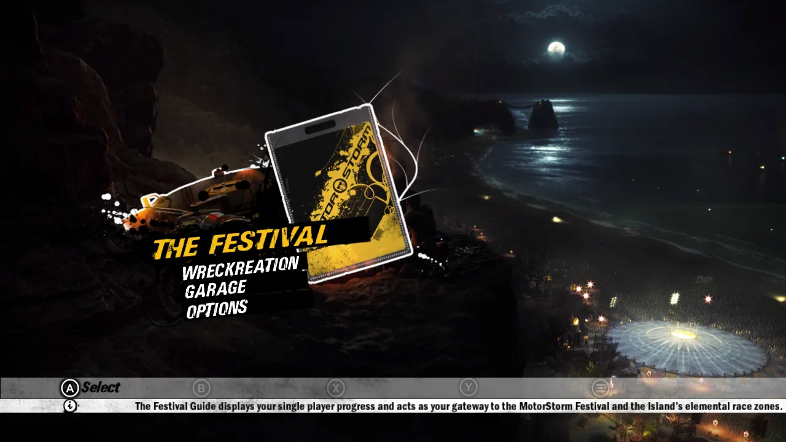
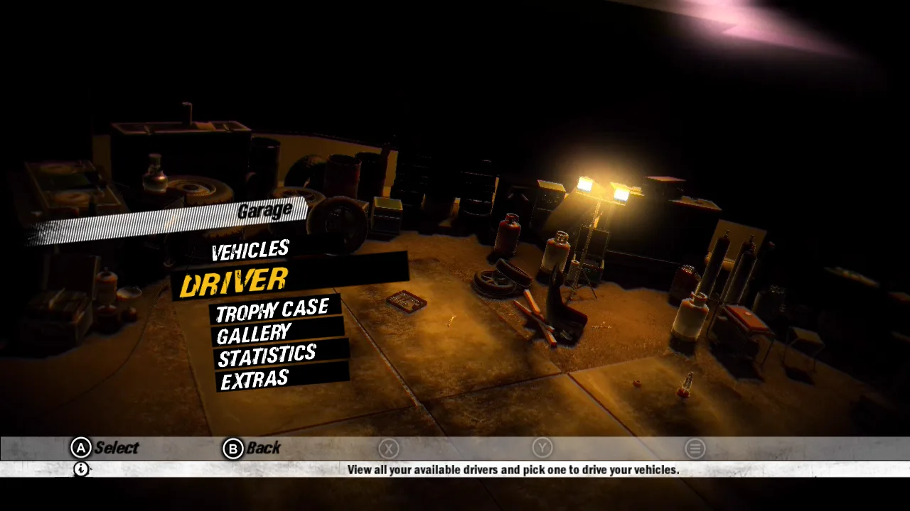
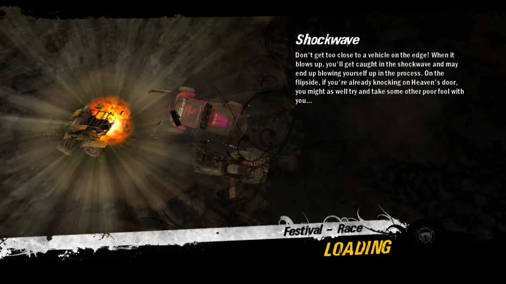

# MotorStorm: PC-ific Rift

**Mud. Volcanoes. Native x64.**

A static recompilation of *MotorStorm: Pacific Rift* (PS3, 2008) into a native Windows
executable. No emulator, no JIT: the game's PowerPC and SPU code is translated ahead of
time into C/C++, compiled with clang, and run on a D3D12 renderer that speaks RSX.

Built on [ps3recomp](https://github.com/sp00nznet/ps3recomp).

## Status

It boots, it loads races, and you can drive a full race at a steady 30 fps.

- ✅ PPU code recompiled (11,722 functions)
- ✅ SPU jobs and SPURS workloads lifted
- ✅ Boots to the front-end menus on D3D12
- ✅ Races load (~10 s) and are drivable with a pad or keyboard
- ✅ In-race rendering: sky, water, tyre tracks, shadows, decals, HUD and exposure fixed
- ✅ Performance: ~28-30 fps in races at the game's native 30 fps cap
- 🚧 Optional 60 fps mode: ~55 fps average, not a locked 60 yet, some camera stutter
- 🚧 Audio polish, remaining visual glitches
- ❌ Not fully playable yet

### Screenshots

| | |
|---|---|
|  |  |
|  |  |
|  |  |

All shots are taken straight from the D3D12 backbuffer at 1280x720.

### Recent progress

- Race frame rate up from ~10-17 fps to ~30 fps: SPURS contention fix, MFC lookup cache,
  double-buffered draw batching, PSO/SRV/texture-environment caches, vertex program
  hash cache and bulk upload, SIMD vertex decode
- Optional 60 fps mode (game speed stays correct): profile-guided build, native SPU
  rounding helpers, hardware FMA and VMX paths
- Race HUD font sizing fixed (lap timer, position and boost readouts)
- Keyboard controls: W/S accelerate/brake, A/D steer, Space boost, Esc pause
- Water spray no longer renders as squares (DXT block un-rotation), 3D shadow textures,
  particle shadows fixed
- Experimental internal resolution scaling (up to 4x), still has cropping issues

#### Earlier

- Race loads cut from ~4 min to ~10 s (real lwcond wake-ups instead of polling)
- Race intro no longer white: small luminance targets are clipped correctly, so auto-exposure works
- sRGB output encode and per-texture sRGB degamma, matching the RSX: no more washed-out scenes
- Fixed the shoreline seam, cyan water glow, white sky while driving, edge streaks, flicker and see-through tyre tracks
- Vehicle shadow blobs no longer draw as boxes (depth-to-colour copy, depth bounds, decal-edge clip)
- Fixed a driving crash in the SPU-filled command FIFO

## What you need

Your own legally dumped copy of the game (BCES00129). This repo contains **no game
data, keys, firmware or recompiled game code**, and never will. Everything
title-specific is generated locally from your own dump.

---

*Not affiliated with Sony Interactive Entertainment or Evolution Studios.
MotorStorm is a trademark of Sony Interactive Entertainment.*
