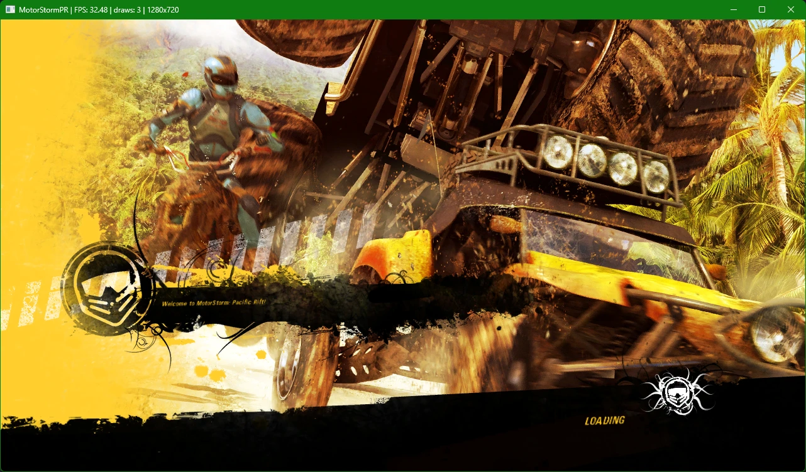

# MotorStorm: PC-ific Rift

**Mud. Volcanoes. Native x64.**

A static recompilation of *MotorStorm: Pacific Rift* (PS3, 2008) into a native Windows
executable. No emulator, no JIT: the game's PowerPC and SPU code is translated ahead of
time into C/C++, compiled with clang, and run on a D3D12 renderer that speaks RSX.

Built on [ps3recomp](https://github.com/sp00nznet/ps3recomp).

## Status

It boots, it loads races, and you can drive. Slowly.

- ✅ PPU code recompiled (11,722 functions)
- ✅ SPU jobs and SPURS workloads lifted
- ✅ Boots to the front-end menus on D3D12
- ✅ Races load (~10 s) and are drivable
- ✅ In-race rendering: sky, water, tyre tracks, vehicle shadows, decals and exposure fixed
- 🚧 Performance: ~10-17 fps in races, ~30 in light scenes
- 🚧 Audio polish, remaining visual glitches
- ❌ Not fully playable yet

### Recent progress

- Race loads cut from ~4 min to ~10 s (real lwcond wake-ups instead of polling)
- Race intro no longer white: small luminance targets are clipped correctly, so auto-exposure works
- sRGB output encode and per-texture sRGB degamma, matching the RSX: no more washed-out scenes
- Fixed the shoreline seam, cyan water glow, white sky while driving, edge streaks, flicker and see-through tyre tracks
- Vehicle shadow blobs no longer draw as boxes (depth-to-colour copy, depth bounds, decal-edge clip)
- Fixed a driving crash in the SPU-filled command FIFO
- Perf: high-resolution timer for guest sleeps, texture hash memo, cached depth lookups

## What you need

Your own legally dumped copy of the game (BCES00129). This repo contains **no game
data, keys, firmware or recompiled game code**, and never will. Everything
title-specific is generated locally from your own dump.

---

*Not affiliated with Sony Interactive Entertainment or Evolution Studios.
MotorStorm is a trademark of Sony Interactive Entertainment.*
